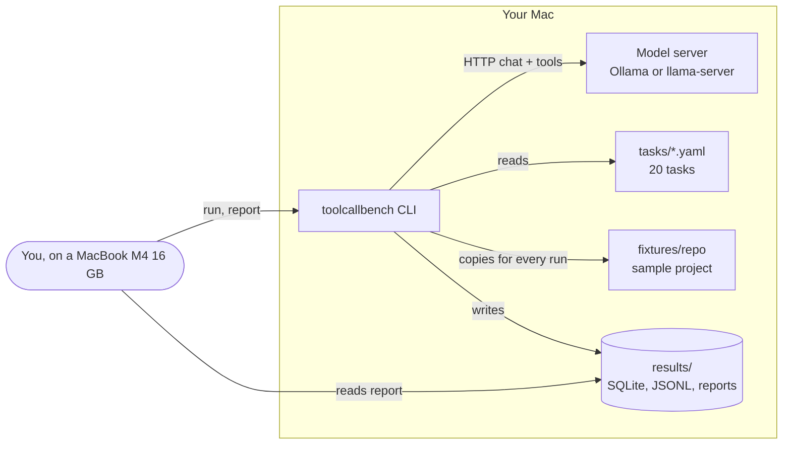
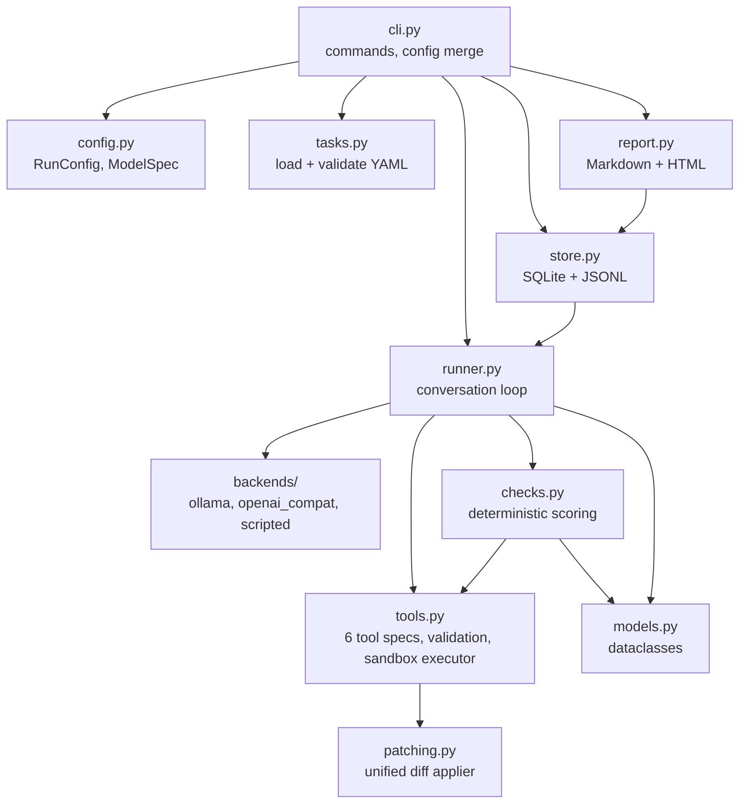
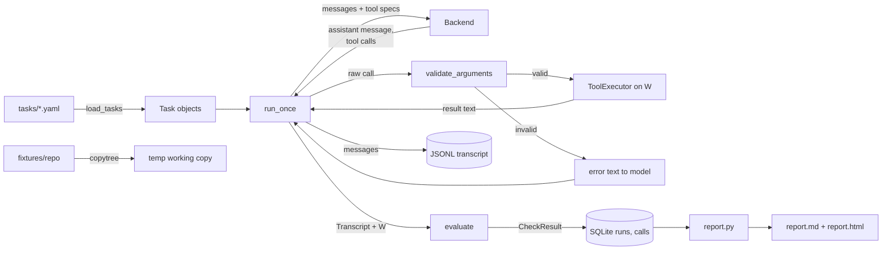
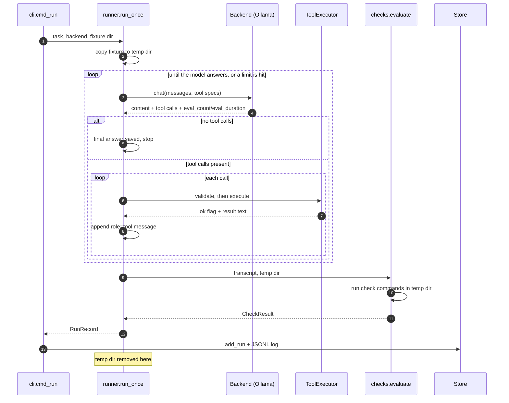
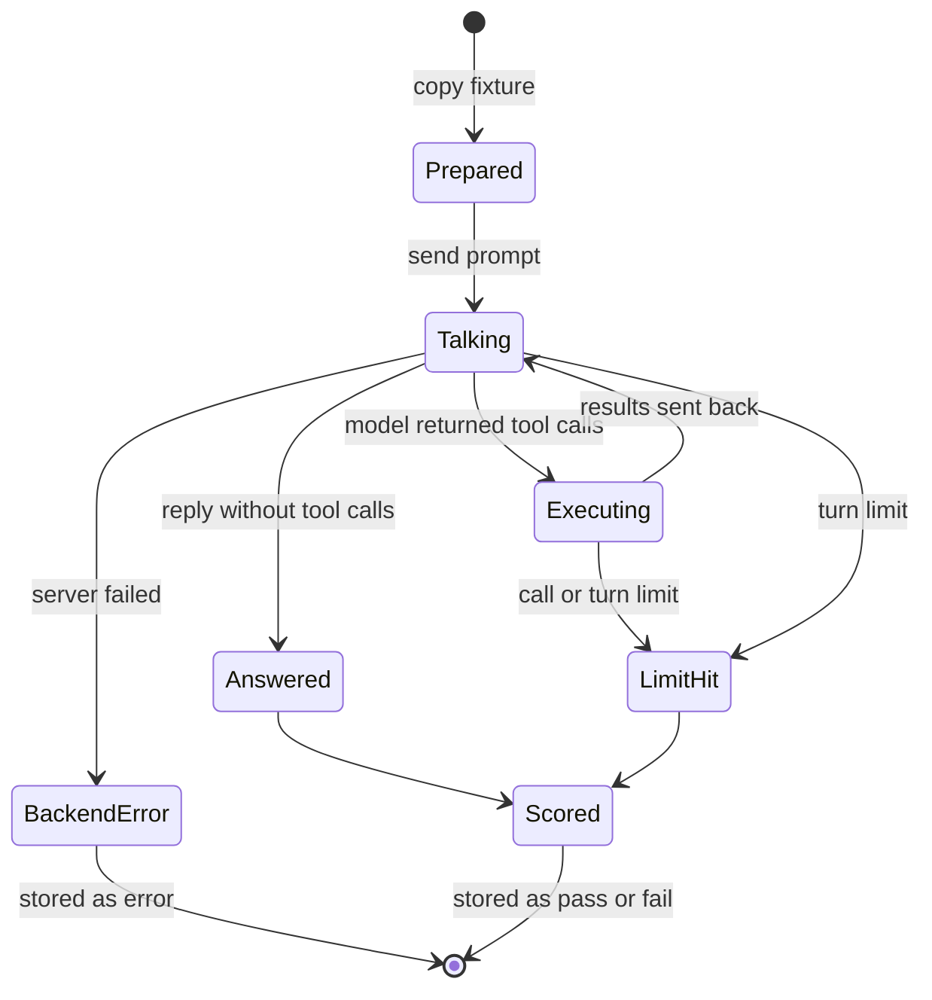
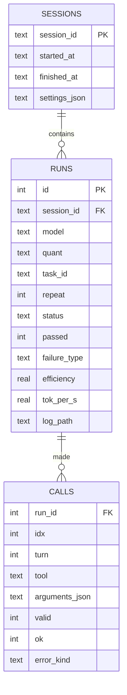
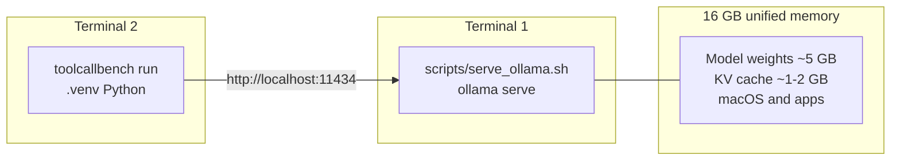

# Architecture

ToolCallBench is a single Python program that talks to a model server over HTTP. It has no
web server, no background service and no cloud dependency. This document shows the system
from five angles: context, components, data flow, run sequence, and storage.

## 1. System context

Everything stays on the Mac. The only network traffic is `localhost` HTTP to the model server.

## 2. Components

| Module | Responsibility | Knows about |
| --- | --- | --- |
| `cli.py` | Parse arguments, merge config file and flags, drive a session | everything |
| `config.py` | Defaults and YAML config loading | nothing else |
| `tasks.py` | Load task files, validate them against a JSON Schema | `models` |
| `runner.py` | Run one task: talk to the backend, execute tool calls, then score | backends, tools, checks |
| `backends/` | One class per server type; return a uniform `BackendResponse` | `models` |
| `tools.py` | Tool JSON schemas, argument validation, sandboxed execution | `patching` |
| `checks.py` | Turn a transcript and the final repo state into a verdict | `tools` (to run check commands) |
| `store.py` | Persist sessions, runs and calls; write transcripts | `runner` (for `RunRecord`) |
| `report.py` | Aggregate runs and render Markdown and HTML | `store`, `checks` |

## 3. Data flow

Key point: the model never touches your real files. Every run gets a new copy of
`fixtures/repo`, and the copy is deleted after scoring.

## 4. Sequence of one run

If the backend raises `BackendError` (server down, HTTP error), the run is stored with
status `error` and is **not** counted as a model failure.

## 5. Run state machine

## 6. Storage model

`UNIQUE (session_id, model, task_id, repeat)` on `runs` is what makes `--resume` safe: a run
that is already stored is skipped and can never be stored twice.

## 7. Deployment on a MacBook M4 with 16 GB

One model is loaded at a time (`OLLAMA_MAX_LOADED_MODELS=1`). When the benchmark moves to the
next model, Ollama unloads the old one. See `MODEL_GUIDE_M4_16GB.md` for the budget.

## 8. Extension points

| To add | Touch |
| --- | --- |
| A new task | one YAML file in `tasks/`; run `validate-tasks` |
| A new tool | `tools.py` (spec + handler), the system prompt if needed, tests |
| A new backend | a class in `backends/`, one line in `make_backend` |
| A new failure type | `checks.py`, `FAILURE_TYPES`, `TECH_SPEC.md`, a scripted profile and a test |
| Your own repository | pass `--fixture PATH` and write tasks for it |
